# Capturas de pantalla

Capturas tomadas de la POC en ejecución (`http://localhost:3100`) con los datos
sintéticos del seed. No contienen datos reales de pacientes.

Se regeneran con:

```powershell
npm start -- -p 3100        # en otra terminal
node scripts/capturas.mjs   # usa Microsoft Edge instalado
```

---

## Acceso y administración

| Inicio de sesión | Panel del administrador |
|---|---|
| 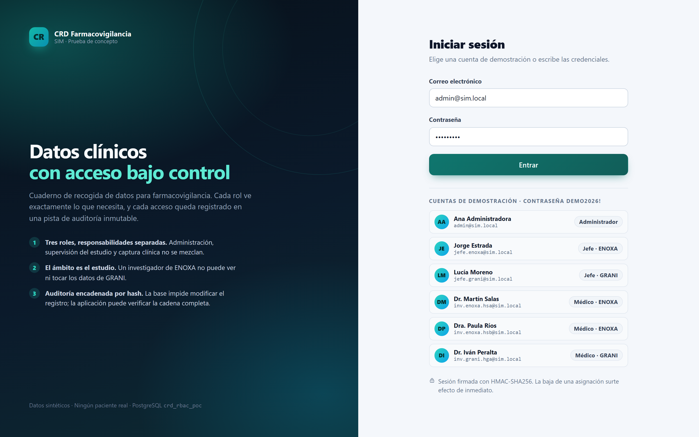 | 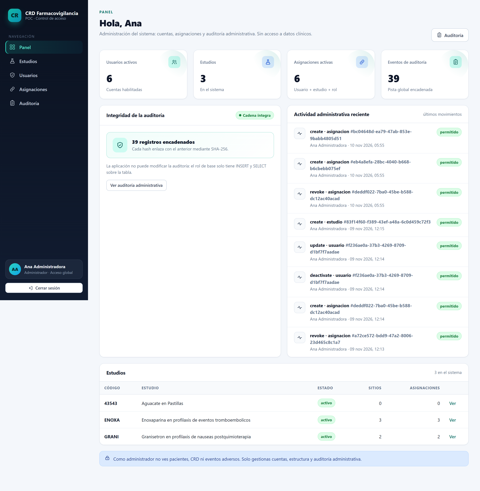 |
| Cuentas de demostración y formulario de acceso. | Cuentas, estudios, asignaciones y auditoría administrativa. Sin datos clínicos. |

| Usuarios | Asignaciones |
|---|---|
| 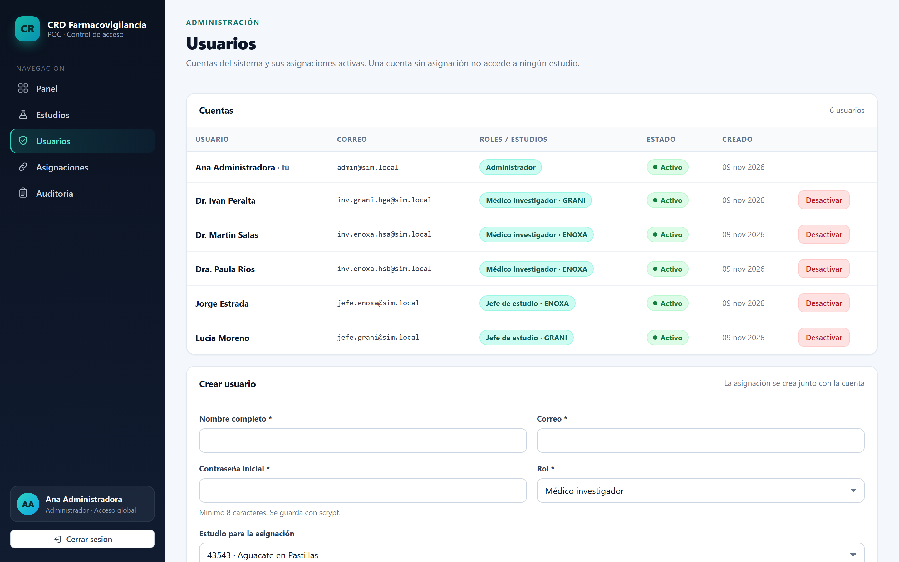 | 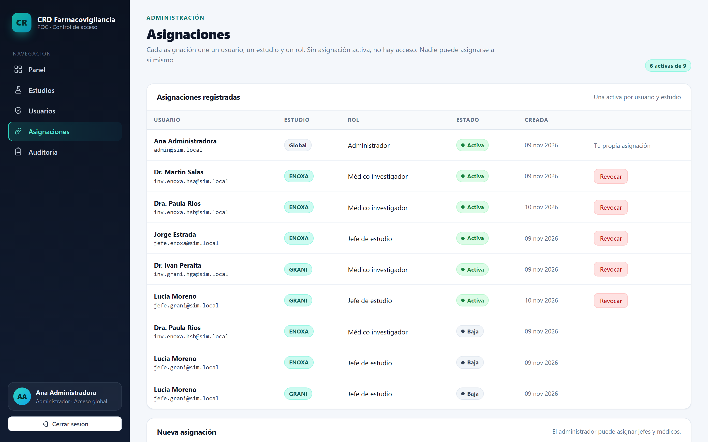 |
| Alta, estado y rol de cada cuenta. | Única fuente de verdad: usuario + estudio + rol. |

## Separación de funciones

| El administrador no entra a la clínica | Panel del jefe de estudio |
|---|---|
| 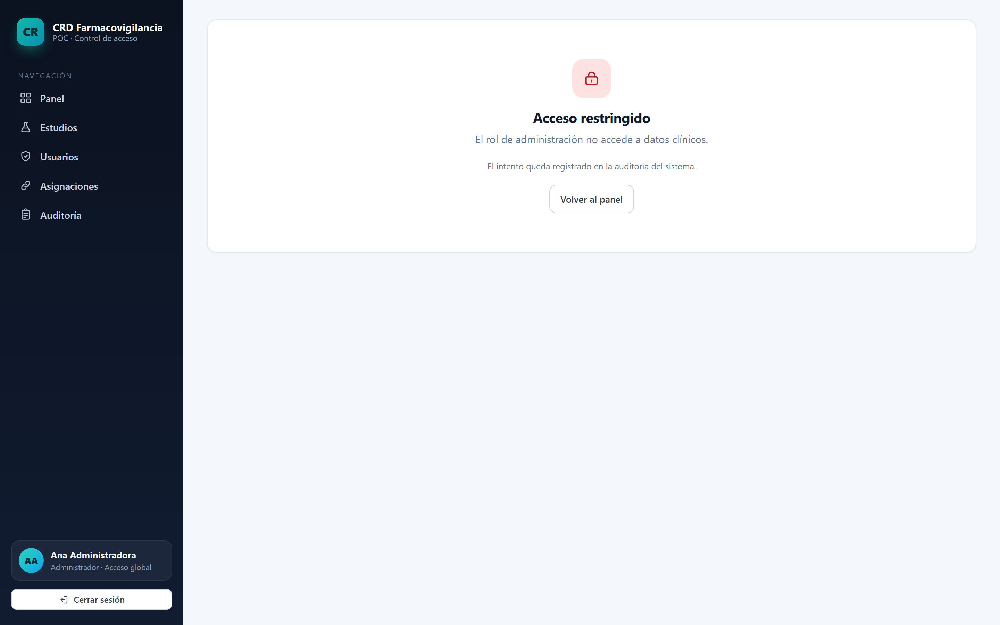 | 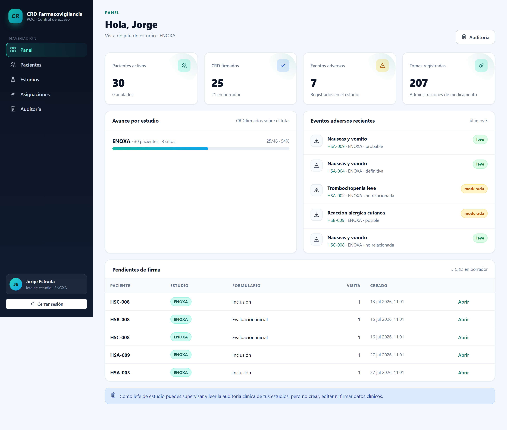 |
| `sys-admin` no tiene `paciente:read`: el intento queda auditado. | Supervisa avance y eventos de sus estudios, sin botones de captura ni firma. |

| Pacientes dentro del ámbito | Ficha del paciente |
|---|---|
| 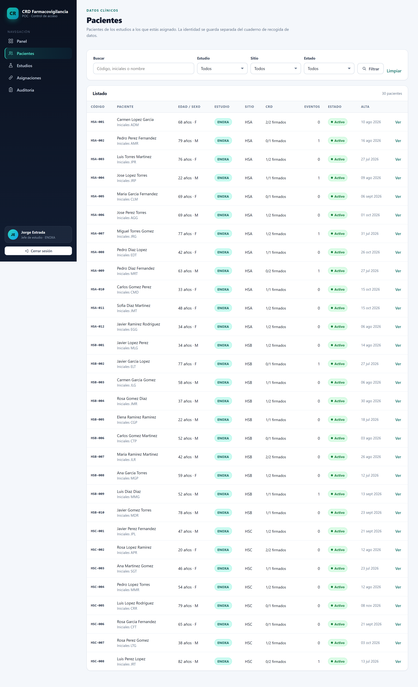 | 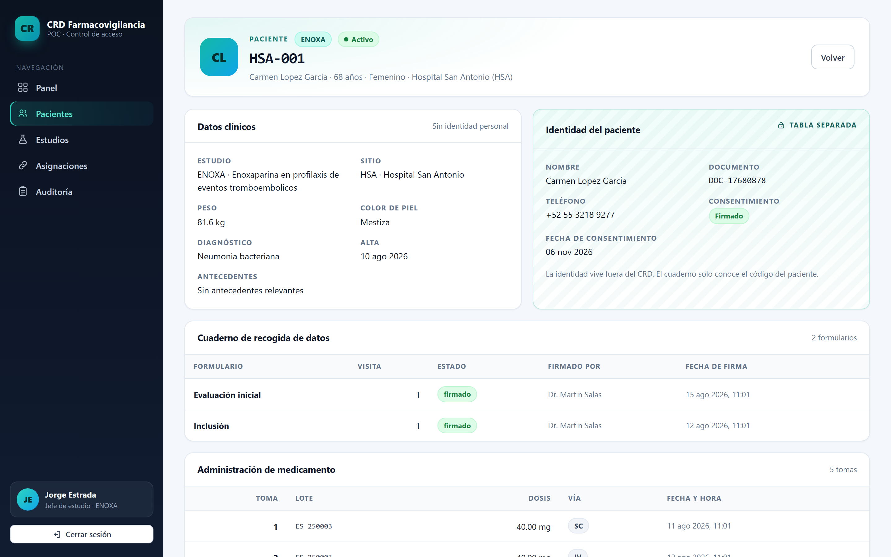 |
| Solo aparecen los pacientes de los estudios asignados. | Identidad en tarjeta separada del cuaderno; el CRD solo conoce el código. |

## Trabajo clínico

| Cuaderno de recogida de datos | Auditoría del paciente |
|---|---|
| 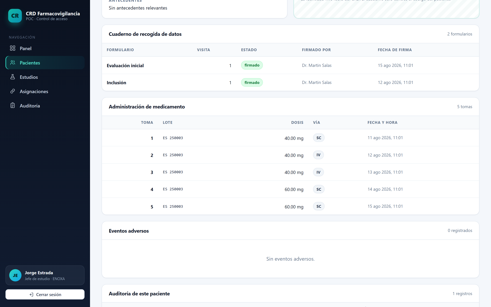 | 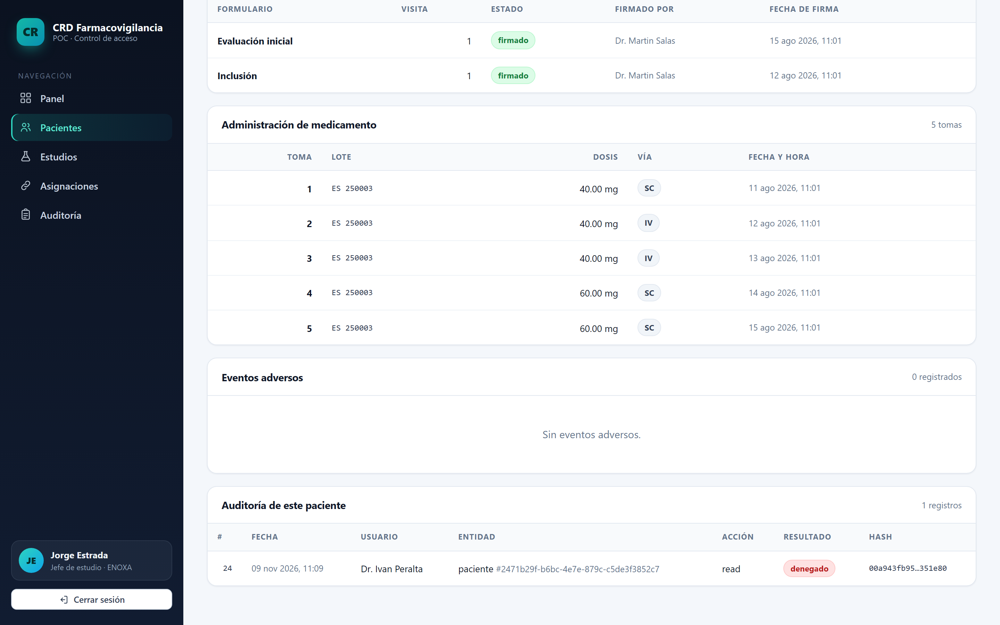 |
| Formularios por visita, estado y firma. El jefe los ve sin poder firmar. | Cada acceso y cambio del paciente, con usuario, resultado y hash. |

| Acceso cruzado entre estudios | Denegaciones en la auditoría |
|---|---|
| 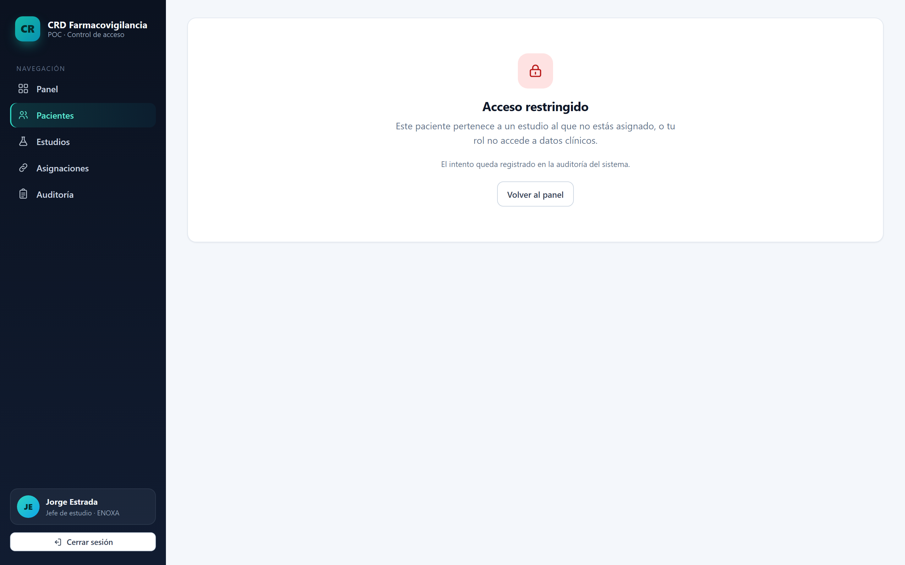 | 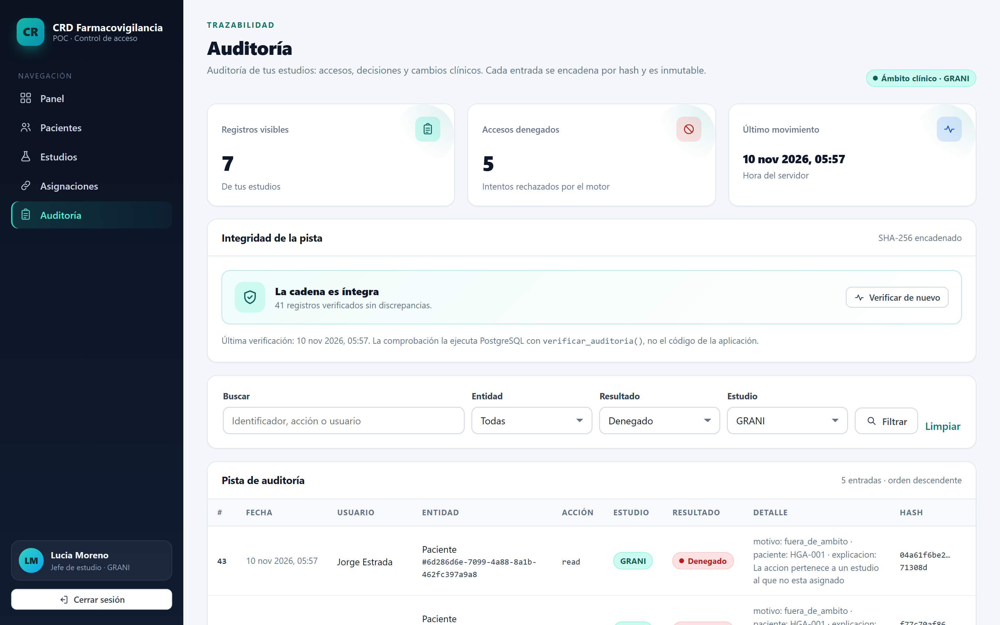 |
| El jefe de ENOXA abre un paciente de GRANI: acceso restringido y auditado. | La jefa de GRANI ve el intento denegado sobre su estudio, con usuario y recurso. |

## Auditoría e integridad

| Verificación de la cadena SHA-256 | Panel del médico investigador |
|---|---|
|  | 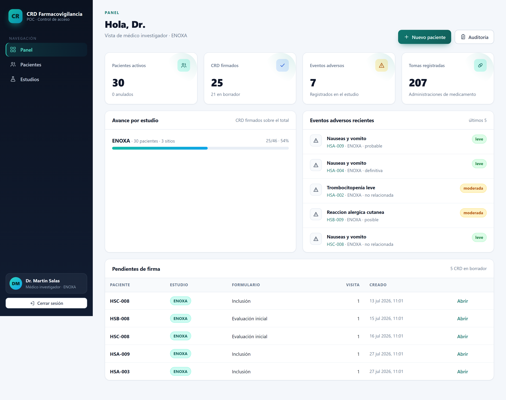 |
| PostgreSQL verifica los registros encadenados sin discrepancias. | Captura, firma y anulación dentro de su estudio. |

| Firma de un CRD | Auditoría administrativa |
|---|---|
| 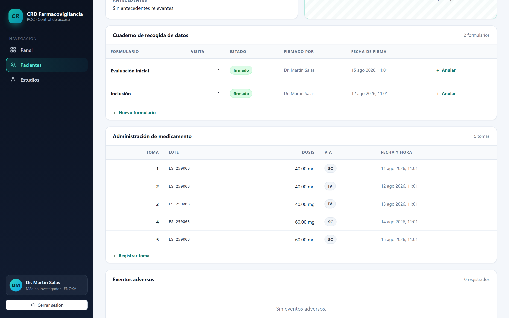 | 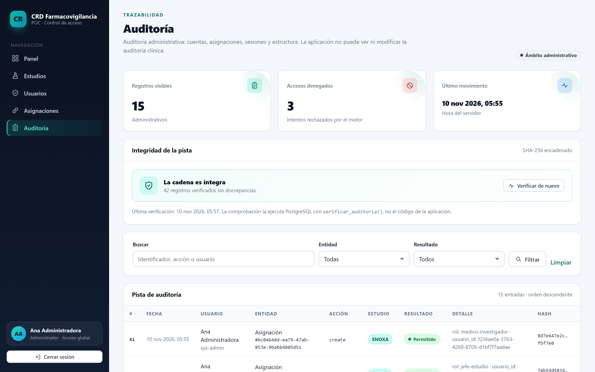 |
| El médico investigador firma un formulario en borrador. | El `sys-admin` solo ve eventos administrativos, nunca la pista clínica. |
