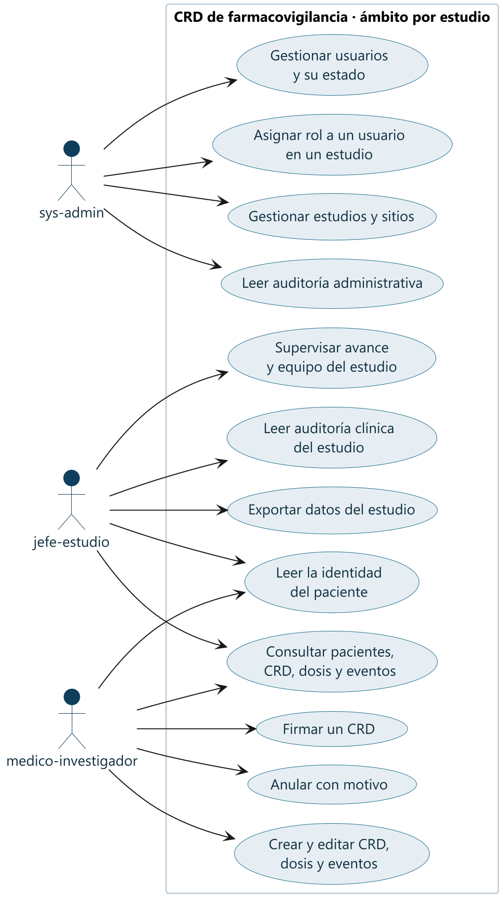
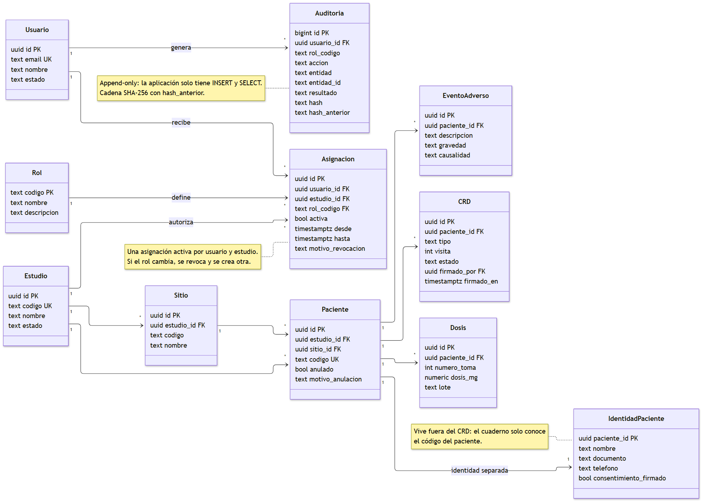
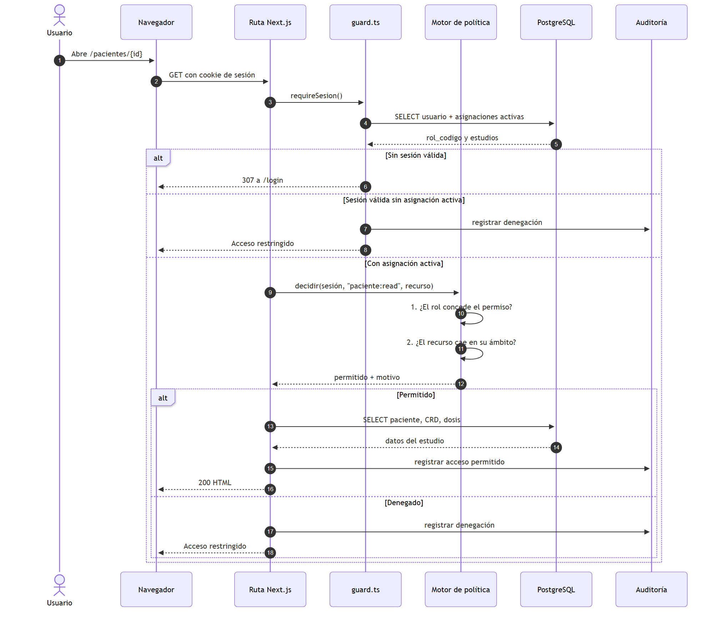
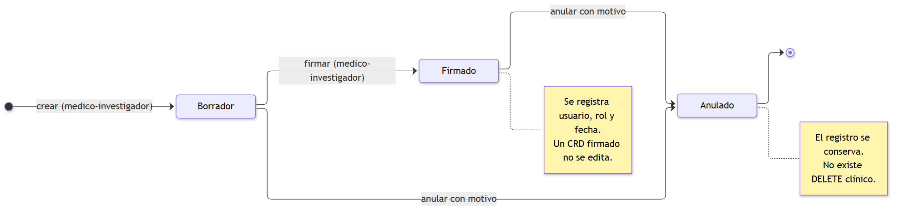
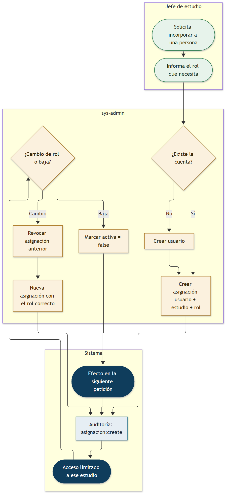

# Diagramas UML

Diagramas del modelo de acceso y del flujo clínico del CRD. Son la vista gráfica de
[`roles-y-permisos.md`](../roles-y-permisos.md) y del
[`ADR-001`](../adr/ADR-001-modelo-roles-y-asignaciones.md).

| # | Diagrama | Tipo UML | Fuente | Imagen |
|---|---|---|---|---|
| 1 | Casos de uso por rol | Casos de uso | [`casos-de-uso.puml`](./casos-de-uso.puml) | [PNG](./casos-de-uso.png) · [SVG](./casos-de-uso.svg) |
| 2 | Modelo de datos | Clases | [`modelo-datos.mmd`](./modelo-datos.mmd) | [PNG](./modelo-datos.png) · [SVG](./modelo-datos.svg) |
| 3 | Autorización de una petición | Secuencia | [`secuencia-autorizacion.mmd`](./secuencia-autorizacion.mmd) | [PNG](./secuencia-autorizacion.png) · [SVG](./secuencia-autorizacion.svg) |
| 4 | Ciclo de vida de un CRD | Estados | [`estados-crd.mmd`](./estados-crd.mmd) | [PNG](./estados-crd.png) · [SVG](./estados-crd.svg) |
| 5 | Alta, cambio y baja de una asignación | Actividad | [`proceso-asignacion.mmd`](./proceso-asignacion.mmd) | [PNG](./proceso-asignacion.png) · [SVG](./proceso-asignacion.svg) |

Las fuentes Mermaid se renderizan directamente en GitHub; las imágenes están
incluidas para que los diagramas se vean también fuera de GitHub (Word, PDF,
presentaciones).

---

## 1. Casos de uso por rol

Cada actor solo alcanza los casos de uso que su rol concede. El administrador no
toca la clínica; el jefe supervisa sin escribir; el médico captura y firma.

## 2. Modelo de datos

La asignación (`usuario + estudio + rol + activa`) es la única fuente de verdad
de los roles. La identidad del paciente vive en una tabla aparte y la auditoría
solo admite `INSERT` y `SELECT`.

## 3. Autorización de una petición

Una sola capa de decisión en el servidor: sesión, permiso del rol y ámbito del
recurso. Todo resultado —permitido o denegado— se audita.

## 4. Ciclo de vida de un CRD

Sin borrado clínico: el formulario pasa de borrador a firmado y solo puede
anularse con motivo, conservando el registro original.

## 5. Alta, cambio y baja de una asignación

El jefe de estudio solicita; el `sys-admin` crea la asignación. Un cambio de rol
revoca la anterior y crea una nueva, y la baja surte efecto en la siguiente
petición.

